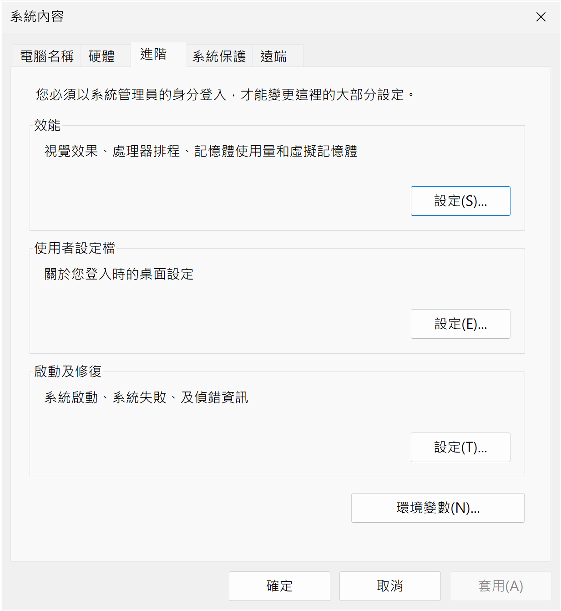
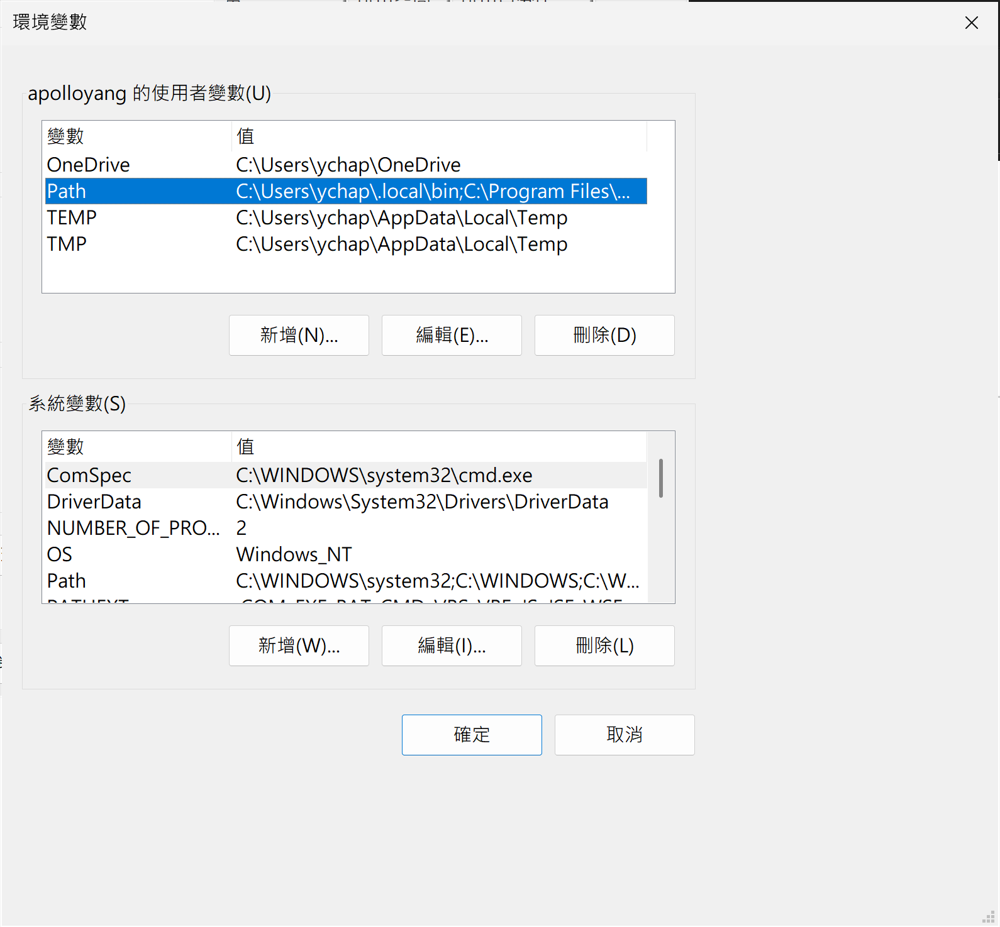
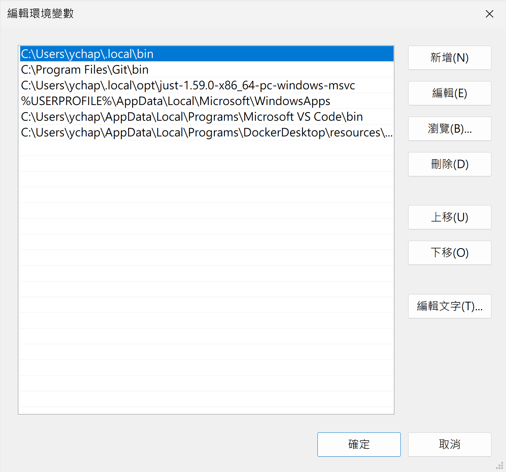
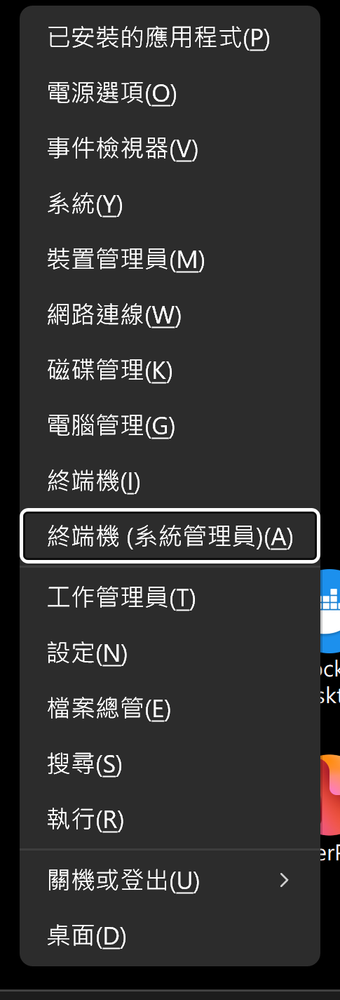
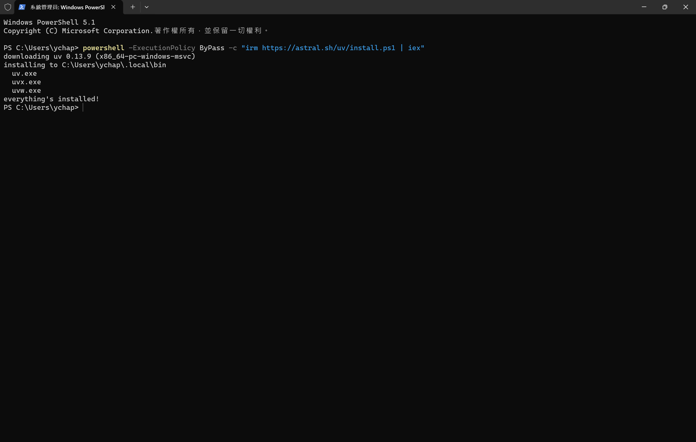

# Schedify

## 開發環境

### Windows

1. `Just`

    1. 下載[`Just`](https://github.com/casey/just/releases/download/1.59.0/just-1.59.0-x86_64-pc-windows-msvc.zip)

    2. 下載壓縮檔，將解壓縮出來的資料夾放到`C:\使用者\<你的使用者名稱>\.local\opt`底下

    3. 於控制台的搜索`環境`，並點擊`編輯系統環境變數`，打開`系統內容`視窗

        

    4. 點擊`環境變數`，打開`環境變數`視窗

        

    5. 雙擊`<你的使用者名稱>的使用者變數`裡面的`Path`變數，打開`編輯環境變數視窗`

        

    6. 點擊`新增`並輸入`C:\使用者\<你的使用者名稱>\.local\opt\just-1.59.0-x86_64-pc-windows-msvc`

        

    7. 一路確定回`系統內容`視窗

2. `uv`

    1. 右鍵工作列上的`Windows`圖標，並選擇`終端機 (系統管理員)`

        

    2. `powershell -ExecutionPolicy ByPass -c "irm https://astral.sh/uv/install.ps1 | iex`

        

3. `TailwindCSS`

    1. 下載[`TailwindCSS`](https://github.com/tailwindlabs/tailwindcss/releases/download/v4.3.5/tailwindcss-windows-x64.exe)

    2. 重新命名`tailwindcss-windows-x64.exe`為`tailwindcss.exe`，並將其移動到`C:\使用者\<你的使用者名稱>\.local\bin`底下

### Linux

1. `Docker`

    ```bash
    curl -fsSL https://get.docker.com | sudo sh
    ```

2. `Dev Container`

    1. 於`VSCode`中安裝[`Remote Development`](https://marketplace.visualstudio.com/items?itemName=ms-vscode-remote.vscode-remote-extensionpack)擴充功能

    2. 於專案根目錄下按下`F1`，並搜尋`rebuild`，選擇`Dev Containers: Rebuild Container`

    > 補充：
    >
    > 由於`Dockerfile`有使用`Docker BuildKit`，將會於宿主機某處存儲快取，以加速構件，請注意磁碟可用空間。
    >
    > 調整`Dev Container`配置時，經多次`Rebuild`驗證配置將會產生多個`Build Cache`。`Docker BuildKit Build Cache`的相關指令如下：
    >
    > - 查詢`Build Cache`：`docker builder du`
    >
    > ```
    > apolloyang@s5606ma:~$ docker builder du
    > ID                           RECLAIMABLE   SIZE       LAST ACCESSED
    > zn7nsvx1hl6mj4opuxguqprx3*   true          0B         3 hours ago
    > xownkxeheaodnsb42orst9x2m    true          32B*       3 hours ago
    > qhhe453ugjcg2x2tsxb4sfbd0    true          99B*       3 hours ago
    > cwcnv1bz262s6afqgc5ywkz27*   true          4.096kB    3 hours ago
    > 3iqkmeqr9lamk052fq9jb5iuk*   true          12.29kB    3 hours ago
    > hsgknp3gqk4yb4a1l4kyb945c    true          22.15MB*   3 hours ago
    > cffl88ddqvig04c5bcdik08wy    true          91.1MB*    3 hours ago
    > 8pzjjc220wi30rfoqqv05oiz5    true          181.8MB*   3 hours ago
    > oxs6q4hkpmaew06yamce21rvx    true          242.9MB*   3 hours ago
    > z2sc3qexnoaq5afybxdc99x4n    true          267.6MB*   3 hours ago
    > Shared:		805.6MB
    > Private:	16.38kB
    > Reclaimable:	805.6MB
    > Total:		805.6MB
    > ```
    >
    > - 刪除所有沒有使用的`Build Cache`：`docker builder prune -a`
    >
    > ```
    > apolloyang@s5606ma:~$ docker builder prune -a
    > WARNING! This will remove all build cache. Are you sure you want to continue? [y/N] y
    > ID						RECLAIMABLE	SIZE		LAST ACCESSED
    > zn7nsvx1hl6mj4opuxguqprx3*              	true 		0B        	8 minutes ago
    > cwcnv1bz262s6afqgc5ywkz27*              	true 	4.096kB   	8 minutes ago
    > 3iqkmeqr9lamk052fq9jb5iuk*              	true 	12.29kB   	3 hours ago
    > hsgknp3gqk4yb4a1l4kyb945c               	true 	22.15MB   	3 hours ago
    > qhhe453ugjcg2x2tsxb4sfbd0               	true 	99B       	3 hours ago
    > oxs6q4hkpmaew06yamce21rvx               	true 	242.9MB   	3 hours ago
    > xownkxeheaodnsb42orst9x2m               	true 	32B       	4 hours ago
    > z2sc3qexnoaq5afybxdc99x4n               	true 	267.6MB   	4 hours ago
    > cffl88ddqvig04c5bcdik08wy               	true 	91.1MB    	4 hours ago
    > 8pzjjc220wi30rfoqqv05oiz5               	true 	181.8MB   	4 hours ago
    > Total:	805.6MB
    > ```
    > - 強制刪除所有沒有使用的`Build Cache`：`docker builder prune -af`
    >
    > ```
    > ```

## 啟動`Django`

1. 於`VSCode`打開一個終端（`Ctrl+Shift+~`），執行`just debug-css`
2. 打開另一個終端（`Ctrl+Shift+~`），執行`just runserver`

## 技術棧

### 前端

- `Django Template Language`
- `TailwindCSS`
- `Alpine.js`
- `HTMX`

### 後端

- `Django`
- `SQLite`